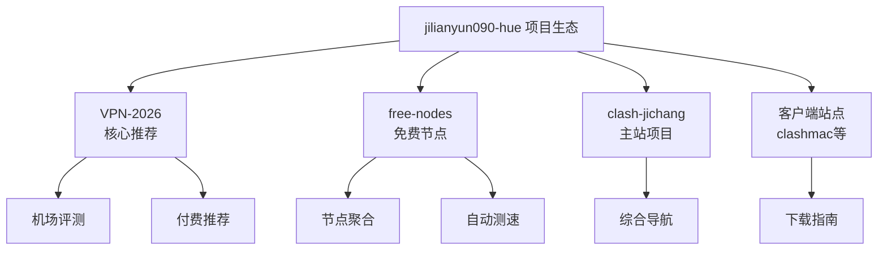

# 机场推荐 · 梯子节点 · 客户端教程 · 翻墙VPN · 梯子节点精品聚合

   

  

---

## 📚 关于本项目

这里汇总 [clash-jichang.com](https://clash-jichang.com/) 与 GitHub 仓库里最值得收藏的网络节点、梯子专线、Clash/小火箭配置指南与翻墙科普。数据每天由 GitHub Actions 自动同步更新。

---

## 🚀 核心仓库导航

| 仓库名称 | 内容特色与优势 | 来源 | Stars |
| :--- | :--- | :---: | :---: |
| 🌟 **[VPN-2026](https://github.com/jilianyun090-hue/VPN-2026)** | 精选2026年度高品质机场服务，按性价比、稳定性、高端专线分类推荐，包含详细套餐对比、实测速度报告及风险提示 | 道一博客 |  |
| ⚡ **[free-nodes](https://github.com/jilianyun090-hue/free-nodes)** | 自动化采集与测速的免费节点库，支持Clash/V2Ray/Shadowrocket一键订阅，每日0点自动更新可用节点 | 道一博客 |  |
| 🏠 **[clashmac.vip](https://github.com/jilianyun090-hue/clashmac.vip)** | Mac平台Clash系客户端完整使用手册，涵盖下载安装、订阅配置、规则设置等全流程指导 | MAC机场 |  |
| 📱 **[clash-jichang](https://github.com/jilianyun090-hue/clash-jichang)** | 主流机场服务深度评测，包括线路质量分析、解锁能力测试、实际使用体验及套餐性价比对比 | 道一博客 |  |
| 🎯 **[jichangdaquan](https://github.com/jilianyun090-hue/jichangdaquan)** | 跨平台代理客户端大全，收录Windows/macOS/iOS/Android全平台90+款工具及配置教程 | 机场大全 |  |
| 🔧 **[tizibest](https://github.com/jilianyun090-hue/tizibest)** | 科学上网技术百科，解析代理协议原理、网络线路知识、常见问题排查及AI工具使用技巧 | 梯子中文网 |  |
| 💻 **[clash-vpns.my](https://github.com/jilianyun090-hue/clash-vpns.my)** | 机场服务风险预警系统，实时更新已跑路/即将停服的服务商名单，帮助用户避坑 | clash机场 |  |
| 📊 **[tuijichang](https://github.com/jilianyun090-hue/tuijichang)** | 行业资讯与技术动态追踪，包括代理协议发展、客户端版本更新、安全事件通报等内容 | 推机场 |  |

---

## 📱 全平台客户端教程

### 🖥️ Windows 客户端

| 客户端 | 特色说明 | 图文教程 |
| :--- | :--- | :---: |
| **Clash Verge Rev** | 目前最推荐的电脑端 Clash 内核客户端，支持中文，UI 界面简洁且功能强大，全面支持 Windows 和 macOS | [查看教程](https://clashmac.vip/2026/03/29/clash-verge-rev-tutorial/) |
| **v2rayN** | 老牌开源 V2Ray 客户端，功能全面稳定，支持多种代理协议，适合进阶用户使用 | [查看教程](https://clashmac.vip/2026/03/29/v2rayn-v2-tutorial/) |
| **FLclash** | 基于 Flutter 开发的跨平台 Clash 客户端，界面现代化，性能优秀，支持多系统 | [查看教程](https://clashmac.vip/2026/03/29/flclash-tutorial/) |

### 🍎 macOS 客户端

| 客户端 | 特色说明 | 图文教程 |
| :--- | :--- | :---: |
| **Clash Verge Rev** | Mac 平台首选 Clash 客户端，原生支持 Apple Silicon，界面美观流畅 | [查看教程](https://clashmac.vip/2026/03/29/clash-verge-rev-tutorial/) |
| **ClashMi** | 轻量级 Mac Clash 客户端，资源占用低，适合日常轻度使用 | [查看教程](https://clashmac.vip/2026/03/29/clashmi-tutorial/) |

### 📱 iOS 客户端

| 客户端 | 特色说明 | 图文教程 |
| :--- | :--- | :---: |
| **Clash Party** | iOS 平台优秀的 Clash 客户端，界面友好，配置简单，支持多种订阅格式 | [查看教程](https://clashmac.vip/2026/03/29/clash-party-tutorial/) |

### 🤖 Android 客户端

| 客户端 | 特色说明 | 图文教程 |
| :--- | :--- | :---: |
| **Clash Meta (Android)** | Android 平台主流 Clash 客户端，基于 Meta 内核，功能强大，规则灵活 | [查看教程](https://clashmac.vip/2026/03/29/clash-meta-android-tutorial/) |

> 💡 **提示**: 所有教程均包含详细的下载链接、安装步骤、订阅配置和常见问题解决方案

---

## 📖 快速开始

### 新手入门
1. **选择机场**: 访问 [VPN-2026](https://github.com/jilianyun090-hue/VPN-2026) 查看最新机场推荐
2. **免费体验**: 在 [free-nodes](https://github.com/jilianyun090-hue/free-nodes) 获取每日更新的免费节点
3. **客户端下载**: 查看各仓库的客户端教程，选择适合您的平台

### 进阶使用
- 💡 **专线节点**: 查看 VPN-2026 中的 IEPL/IPLC 高端机场推荐
- 🎬 **流媒体解锁**: 关注支持 Netflix、TikTok 解锁的机场
- 🎮 **游戏加速**: 推荐使用专线节点获得低延迟体验
- 🤖 **AI 专用**: 查找支持 ChatGPT 和 Claude 的纯净 IP 节点

---

## 🌐 生态系统

---

## 💡 核心站点导航

### 官方资源
- 🏠 **主站官网**: [clash-jichang.com](https://clash-jichang.com/)
- 📣 **Telegram 交流群**: [t.me/JLYCloud](https://t.me/JLYCloud)

### 技术支持
- 📖 **使用文档**: 查看各仓库的 README 文件
- 💬 **问题反馈**: 通过 GitHub Issues 提交
- 🔔 **更新通知**: Star 本仓库接收更新推送

---

## 📊 项目数据

  
| 指标 | 数值 |
|:---:|:---:|
| 📦 总仓库数 | 8+ |
| ⭐ 总 Stars | 30+ |
| 🔄 更新频率 | 每日 |
| 🌍 访问量 | 持续增长 |

---

## 🔗 相关链接

### 推荐访问
- [VPN-2026 机场推荐](https://github.com/jilianyun090-hue/VPN-2026) - 2026年最新机场评测
- [免费节点聚合](https://github.com/jilianyun090-hue/free-nodes) - 每日更新免费节点
- [Clash 官网](https://github.com/jilianyun090-hue/clashmac.vip) - Mac 客户端下载

### 友情链接
如需合作或交换友链，请通过 Telegram 联系我们

---

## ⚠️ 免责声明

本项目仅供学习交流使用，请遵守当地法律法规。所有内容均来自公开渠道收集整理，不对任何第三方服务的可用性、安全性、合法性负责。使用任何服务前请自行判断风险。

---

## 📝 更新日志

- **2026-11-21**: 更新首页关联展示，添加项目生态图
- **2026-11-20**: 新增 free-nodes 仓库
- **2026-10-26**: 常规数据更新

---

## 🤝 贡献

欢迎提交 Pull Request 或 Issue 来改进本项目！

---

  
**🌟 如果觉得有用，请给个 Star！**

Made with ❤️ by [jilianyun090-hue](https://github.com/jilianyun090-hue)

