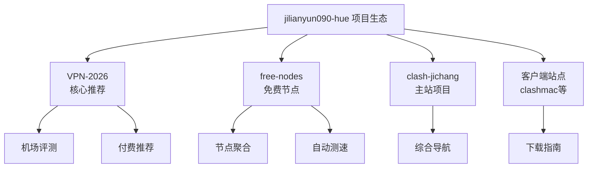

# 机场推荐 · 梯子节点 · 客户端教程 · 翻墙VPN · 梯子节点精品聚合

   

  

---

## 📚 关于本项目

这里汇总 [clash-jichang.com](https://clash-jichang.com/) 与 GitHub 仓库里最值得收藏的网络节点、梯子专线、Clash/小火箭配置指南与翻墙科普。数据每天由 GitHub Actions 自动同步更新。

---

## 🚀 核心仓库导航

| 仓库名称 | 内容特色与优势 | 来源 | Stars |
| :--- | :--- | :---: | :---: |
| 🌟 **[VPN-2026](https://github.com/jilianyun090-hue/VPN-2026)** | 2026 机场推荐清单老牌 / 性价比 / 稳定 / 高端四类整理套餐价格、优惠码、实际全测和已跑路站点同步 | 机场查 |  |
| ⚡ **[free-nodes](https://github.com/jilianyun090-hue/free-nodes)** | 每日免费节点每天 0 点自动更新 Clash / v2ray / 小火箭订阅一键导入 | 机场查 |  |
| 🏠 **[clashmac.vip](https://github.com/jilianyun090-hue/clashmac.vip)** | Clash Mac 客户端下载指南、使用教程、配置文件导入详解 | 机场中文网 |  |
| 📱 **[clash-jichang](https://github.com/jilianyun090-hue/clash-jichang)** | 星岛梦机场怎么样套餐价格、节点测速、解锁与线路评测 | 机场中文网 |  |
| 🎯 **[jichangdaquan](https://github.com/jilianyun090-hue/jichangdaquan)** | 全网最全的机场客户端收集 / 下载 / 图文教程 / 客户端科普与快讯 90 多款按平台分类每日同步 | 机场探 |  |
| 🔧 **[tizibest](https://github.com/jilianyun090-hue/tizibest)** | 翻墙科普攻略原理、线路、故障排查、速坏与 AI 工具每日同步栏目 | 机场中文网 |  |
| 💻 **[clash-vpns.my](https://github.com/jilianyun090-hue/clash-vpns.my)** | 全网最全最新的机场跑路预警名单每日更新下单前先查这家是否跑路 | 机场中文网 |  |
| 📊 **[tuijichang](https://github.com/jilianyun090-hue/tuijichang)** | 机场科普与快讯机场杂谈、协议与内核科普、客户端版本动态每日同步 | 机场帮 + 机场探 |  |

---

## 📖 快速开始

### 新手入门
1. **选择机场**: 访问 [VPN-2026](https://github.com/jilianyun090-hue/VPN-2026) 查看最新机场推荐
2. **免费体验**: 在 [free-nodes](https://github.com/jilianyun090-hue/free-nodes) 获取每日更新的免费节点
3. **客户端下载**: 查看各仓库的客户端教程，选择适合您的平台

### 进阶使用
- 💡 **专线节点**: 查看 VPN-2026 中的 IEPL/IPLC 高端机场推荐
- 🎬 **流媒体解锁**: 关注支持 Netflix、TikTok 解锁的机场
- 🎮 **游戏加速**: 推荐使用专线节点获得低延迟体验
- 🤖 **AI 专用**: 查找支持 ChatGPT 和 Claude 的纯净 IP 节点

---

## 🌐 生态系统

---

## 💡 核心站点导航

### 官方资源
- 🏠 **主站官网**: [clash-jichang.com](https://clash-jichang.com/)
- 📣 **Telegram 交流群**: [t.me/JLYCloud](https://t.me/JLYCloud)

### 技术支持
- 📖 **使用文档**: 查看各仓库的 README 文件
- 💬 **问题反馈**: 通过 GitHub Issues 提交
- 🔔 **更新通知**: Star 本仓库接收更新推送

---

## 📊 项目数据

  
| 指标 | 数值 |
|:---:|:---:|
| 📦 总仓库数 | 8+ |
| ⭐ 总 Stars | 30+ |
| 🔄 更新频率 | 每日 |
| 🌍 访问量 | 持续增长 |

---

## 🔗 相关链接

### 推荐访问
- [VPN-2026 机场推荐](https://github.com/jilianyun090-hue/VPN-2026) - 2026年最新机场评测
- [免费节点聚合](https://github.com/jilianyun090-hue/free-nodes) - 每日更新免费节点
- [Clash 官网](https://github.com/jilianyun090-hue/clashmac.vip) - Mac 客户端下载

### 友情链接
如需合作或交换友链，请通过 Telegram 联系我们

---

## ⚠️ 免责声明

本项目仅供学习交流使用，请遵守当地法律法规。所有内容均来自公开渠道收集整理，不对任何第三方服务的可用性、安全性、合法性负责。使用任何服务前请自行判断风险。

---

## 📝 更新日志

- **2026-11-21**: 更新首页关联展示，添加项目生态图
- **2026-11-20**: 新增 free-nodes 仓库
- **2026-10-26**: 常规数据更新

---

## 🤝 贡献

欢迎提交 Pull Request 或 Issue 来改进本项目！

---

  
**🌟 如果觉得有用，请给个 Star！**

Made with ❤️ by [jilianyun090-hue](https://github.com/jilianyun090-hue)

