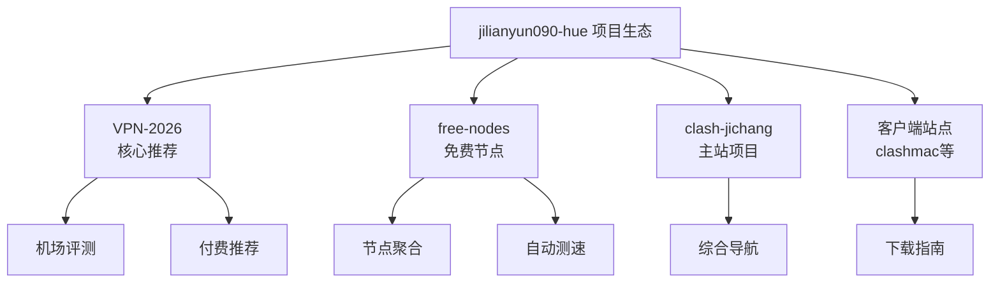

# 机场推荐 · 梯子节点 · 客户端教程 · 翻墙VPN · 梯子节点精品聚合

   

  

---

## 📚 关于本项目

这里汇总 [clash-jichang.com](https://clash-jichang.com/) 与 GitHub 仓库里最值得收藏的网络节点、梯子专线、Clash/小火箭配置指南与翻墙科普。数据每天由 GitHub Actions 自动同步更新。

---

## 🚀 核心仓库导航

<table>
<thead>
<tr>
<th>仓库名称</th>
<th>描述</th>
<th>Stars</th>
<th>技术栈</th>
<th>快速访问</th>
</tr>
</thead>
<tbody>

<tr>
<td>🌟 <a href="https://github.com/jilianyun090-hue/VPN-2026"><strong>VPN-2026</strong></a></td>
<td>2026高速稳定机场推荐与科学上网翻墙机场评测指南。高口碑性价比便宜机场推荐，完美替代经典VPN。全节点解锁流媒体（Netflix/TikTok运营机场），专线节点直连提供游戏加速及4K超清体验</td>
<td></td>
<td>JavaScript</td>
<td><a href="https://github.com/jilianyun090-hue/VPN-2026">查看详情</a></td>
</tr>

<tr>
<td>⚡ <a href="https://github.com/jilianyun090-hue/free-nodes"><strong>free-nodes</strong></a></td>
<td>每日免费节点测速与整理（支持 Clash / Shadowrocket 订阅导入）</td>
<td></td>
<td>JavaScript</td>
<td><a href="https://github.com/jilianyun090-hue/free-nodes">查看详情</a></td>
</tr>

<tr>
<td>🏠 <a href="https://github.com/jilianyun090-hue/clashmac.vip"><strong>clashmac.vip</strong></a></td>
<td>Clash Mac 官网与下载指南</td>
<td></td>
<td>HTML</td>
<td><a href="https://github.com/jilianyun090-hue/clashmac.vip">查看详情</a></td>
</tr>

<tr>
<td>📱 <a href="https://github.com/jilianyun090-hue/clash-jichang"><strong>clash-jichang</strong></a></td>
<td>Clash 机场主站项目</td>
<td></td>
<td>JavaScript</td>
<td><a href="https://github.com/jilianyun090-hue/clash-jichang">查看详情</a></td>
</tr>

<tr>
<td>🎯 <a href="https://github.com/jilianyun090-hue/jichangdaquan"><strong>jichangdaquan</strong></a></td>
<td>机场大全聚合站点</td>
<td></td>
<td>Astro</td>
<td><a href="https://github.com/jilianyun090-hue/jichangdaquan">查看详情</a></td>
</tr>

<tr>
<td>🔧 <a href="https://github.com/jilianyun090-hue/tizibest"><strong>tizibest</strong></a></td>
<td>梯子测评与推荐</td>
<td></td>
<td>HTML</td>
<td><a href="https://github.com/jilianyun090-hue/tizibest">查看详情</a></td>
</tr>

<tr>
<td>💻 <a href="https://github.com/jilianyun090-hue/clash-vpns.my"><strong>clash-vpns.my</strong></a></td>
<td>Clash VPN 资源站</td>
<td></td>
<td>HTML</td>
<td><a href="https://github.com/jilianyun090-hue/clash-vpns.my">查看详情</a></td>
</tr>

<tr>
<td>📊 <a href="https://github.com/jilianyun090-hue/tuijichang"><strong>tuijichang</strong></a></td>
<td>推荐机场列表</td>
<td></td>
<td>HTML</td>
<td><a href="https://github.com/jilianyun090-hue/tuijichang">查看详情</a></td>
</tr>

</tbody>
</table>

---

## 📖 快速开始

### 新手入门
1. **选择机场**: 访问 [VPN-2026](https://github.com/jilianyun090-hue/VPN-2026) 查看最新机场推荐
2. **免费体验**: 在 [free-nodes](https://github.com/jilianyun090-hue/free-nodes) 获取每日更新的免费节点
3. **客户端下载**: 查看各仓库的客户端教程，选择适合您的平台

### 进阶使用
- 💡 **专线节点**: 查看 VPN-2026 中的 IEPL/IPLC 高端机场推荐
- 🎬 **流媒体解锁**: 关注支持 Netflix、TikTok 解锁的机场
- 🎮 **游戏加速**: 推荐使用专线节点获得低延迟体验
- 🤖 **AI 专用**: 查找支持 ChatGPT 和 Claude 的纯净 IP 节点

---

## 🌐 生态系统

---

## 💡 核心站点导航

### 官方资源
- 🏠 **主站官网**: [clash-jichang.com](https://clash-jichang.com/)
- 📣 **Telegram 交流群**: [t.me/JLYCloud](https://t.me/JLYCloud)

### 技术支持
- 📖 **使用文档**: 查看各仓库的 README 文件
- 💬 **问题反馈**: 通过 GitHub Issues 提交
- 🔔 **更新通知**: Star 本仓库接收更新推送

---

## 📊 项目数据

  
| 指标 | 数值 |
|:---:|:---:|
| 📦 总仓库数 | 8+ |
| ⭐ 总 Stars | 30+ |
| 🔄 更新频率 | 每日 |
| 🌍 访问量 | 持续增长 |

---

## 🔗 相关链接

### 推荐访问
- [VPN-2026 机场推荐](https://github.com/jilianyun090-hue/VPN-2026) - 2026年最新机场评测
- [免费节点聚合](https://github.com/jilianyun090-hue/free-nodes) - 每日更新免费节点
- [Clash 官网](https://github.com/jilianyun090-hue/clashmac.vip) - Mac 客户端下载

### 友情链接
如需合作或交换友链，请通过 Telegram 联系我们

---

## ⚠️ 免责声明

本项目仅供学习交流使用，请遵守当地法律法规。所有内容均来自公开渠道收集整理，不对任何第三方服务的可用性、安全性、合法性负责。使用任何服务前请自行判断风险。

---

## 📝 更新日志

- **2026-11-21**: 更新首页关联展示，添加项目生态图
- **2026-11-20**: 新增 free-nodes 仓库
- **2026-10-26**: 常规数据更新

---

## 🤝 贡献

欢迎提交 Pull Request 或 Issue 来改进本项目！

---

  
**🌟 如果觉得有用，请给个 Star！**

Made with ❤️ by [jilianyun090-hue](https://github.com/jilianyun090-hue)

